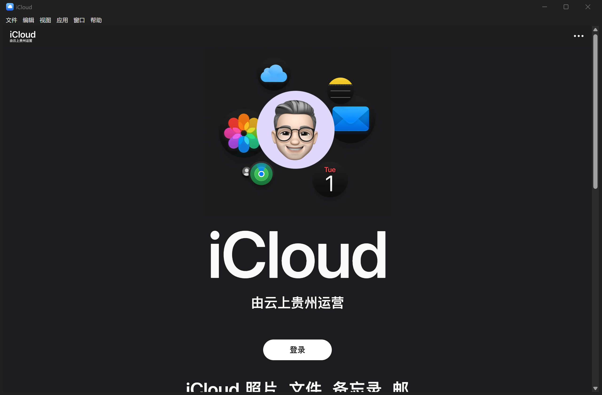
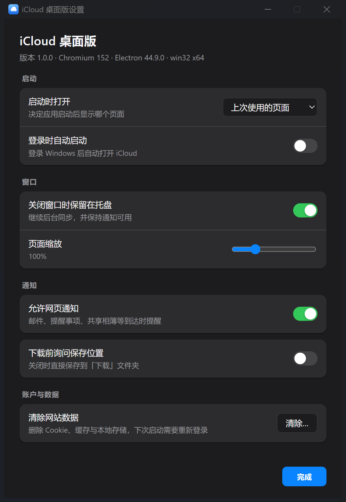
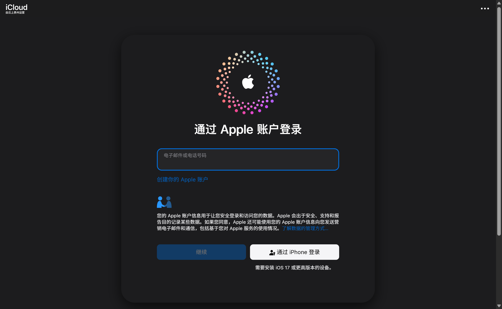
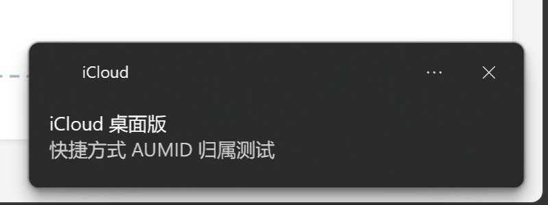

# iCloud 桌面版

[](https://github.com/Niobium-41-nb/icloud-desktop/actions/workflows/build.yml)
[](LICENSE)

把 <https://www.icloud.com.cn/> 的网页版 iCloud 包装成一个 Windows 桌面应用：
独立窗口、常驻托盘、系统级通知、下载管理、深链接和一套键盘快捷键。

网页本身（账户、数据、全部界面）仍由 Apple 的 CloudOS 提供；本应用只补齐
浏览器标签页做不到的那部分桌面能力。**它不是 Apple 官方客户端，也不接触你的
Apple 账户凭据。**

> 逆向过程与站点架构记录在 [docs/REVERSE-ENGINEERING.md](docs/REVERSE-ENGINEERING.md)：
> 为什么不能 iframe、登录为什么必须留在 Apple 页面里、通知为什么要靠快捷方式
> 的 AppUserModelID —— 都在那里。



---

## 快速开始

### 安装（推荐）

```powershell
cd dist\iCloud-win32-x64
powershell -ExecutionPolicy Bypass -File install.ps1
```

安装脚本会：

1. 把程序复制到 `%LOCALAPPDATA%\Programs\iCloud`
2. 创建「开始菜单」和桌面快捷方式，并写入 AppUserModelID
   （Windows 靠它把通知 / 任务栏分组 / 跳转列表归属到 iCloud）
3. 注册 `icloud://` 协议
4. 启动应用

无需管理员权限。卸载：

```powershell
powershell -ExecutionPolicy Bypass -File uninstall.ps1            # 保留登录状态
powershell -ExecutionPolicy Bypass -File uninstall.ps1 -PurgeData # 一并删除数据
```

### 便携运行

不解压到别处、直接双击 `dist\iCloud-win32-x64\iCloud.exe` 也能用——
只是系统通知会显示为 `Electron`（因为没有带 AUMID 的快捷方式）。

### 从源码运行

```powershell
npm install
npm start
```

### 重新打包

```powershell
# 国内网络建议先设置镜像，否则会卡在下载 Electron 压缩包
$env:ELECTRON_MIRROR='https://npmmirror.com/mirrors/electron/'
npm run package
```

产物：

| 路径 | 说明 |
| --- | --- |
| `dist\iCloud-win32-x64\iCloud.exe` | 可执行文件（235.7 MB，含 Electron 运行时） |
| `dist\iCloud-win32-x64\` | 完整程序目录，拷贝即用（369 MB） |
| `release\iCloud-1.0.0-win32-x64.zip` | 单文件分发包（155 MB），解压后运行目录内的 `install.ps1` |

Electron 应用无法做成真正的单文件 exe：程序必须和 `resources\app.asar`、`*.pak`、
`*.dll` 等运行时文件同目录。因此「一个文件」的形态是 ZIP，里面的
`iCloud.exe` 就是可执行文件。

---

## 功能

| 能力 | 说明 |
| --- | --- |
| 持久登录 | 独立配置目录，Cookie / IndexedDB / 会话在重启后保留 |
| 原生窗口 | 中文菜单栏、窗口位置记忆、DPI 自适应、深浅色跟随系统 |
| 托盘常驻 | 关闭窗口时留在托盘，后台保持同步；托盘菜单可直接跳到各模块 |
| 系统通知 | 网页 Notification 转发为 Windows Toast，归属显示为 `iCloud` |
| 下载管理 | 默认存到「下载」，重名自动编号 `(1)(2)`，任务栏显示进度，完成可点击定位 |
| 外部链接隔离 | 非 Apple 域名一律交给默认浏览器，防止在 iCloud 外壳里打开钓鱼页面 |
| 深链接 | `icloud://photos`、`icloud://mail`、`icloud://notes` … 激活已有窗口并跳转 |
| 模块快切 | 菜单或 `Alt+1…9` 直接进入照片 / 云盘 / 邮件 / 备忘录 … |
| 缩放 | `Ctrl` `+` / `-` / `0`，设置里可调到 50%–250%，跨会话记住 |
| 兜底 | 断网显示本地重试页；渲染进程崩溃可一键重载 |
| 诊断 | 生命周期与错误写入 `%APPDATA%\iCloudDesktop\shell.log`（256 KB 轮转） |

### 快捷键

| 组合 | 动作 |
| --- | --- |
| `Ctrl` + `Q` | 退出应用 |
| `Ctrl` + `W` | 关闭窗口（默认隐藏到托盘，可在设置中改为直接退出） |
| `Ctrl` + `Shift` + `W` | 立即隐藏到托盘 |
| `Ctrl` + `R` / `Ctrl` + `Shift` + `R` | 重新加载 / 忽略缓存重新加载 |
| `Ctrl` + `+` / `Ctrl` + `-` / `Ctrl` + `0` | 放大 / 缩小 / 实际大小 |
| `F11` | 全屏 |
| `Ctrl` + `,` | 设置 |
| `Alt` + `0` | iCloud 首页 |
| `Alt` + `1`…`9` | 照片、云盘、邮件、备忘录、通讯录、日历、提醒事项、查找、iCloud+ |
| `Ctrl` + `Shift` + `I` | 开发者工具 |

### 深链接

```powershell
iCloud.exe icloud://photos
iCloud.exe icloud://drive
iCloud.exe icloud://mail
iCloud.exe icloud://notes
iCloud.exe --preferences    # 直接打开设置窗口
```

### 设置



启动页面（上次页面 / 首页）、开机自启、关闭到托盘、页面缩放、通知开关、
下载是否询问位置、清除网站数据。

---

## 登录

首次启动点「登录」，会直接在窗口内嵌出 Apple 的登录页：



这是 appleid.com 的官方嵌入式授权页（`idmsa.apple.com` + `response_mode=web_message`），
在 Electron 里可以正常渲染并完成 6 位验证码/受信任设备验证。如果系统支持
Windows Hello 通行密钥，「通过 iPhone 登录 / 使用通行密钥」也可能可用。



---

## 数据与隐私

* 所有账户数据留在网页会话里：`%APPDATA%\iCloudDesktop`
  （`settings.json` 只存窗口位置、缩放、开关等本地偏好；`shell.log` 是诊断日志）
* 应用不读取、不落盘任何密码或令牌；登录完全发生在 Apple 的页面里
* 除 Apple 域名外不发起任何网络请求；本应用没有自己的服务器
* 设置里的「清除网站数据」会清空 Cookie / 缓存 / 本地存储，等价于退出登录

---

## 已知限制

* **需要 Apple 账户**，且 iCloud 中国区由云上贵州运营；未登录时只能看到官网首页
* **后台推送**：Electron 没有浏览器级的 Web Push 服务，站点的 `pushManager.subscribe()`
  通常会失败。应用运行期间（含最小化到托盘）消息靠站点自身的 WebSocket 通道与
  页面轮询到达；**完全退出后不会收到任何提醒**
* **通行密钥**：取决于 Chromium 在当前系统上能否使用平台认证器；不可用时站点会
  自动退回验证码方式
* **未登录状态下的模块跳转**只显示登录引导页——这是站点本身的行为
* 仅在 Windows x64 + Electron 44（Chromium 152）上验证过；`npm run package` 可改目标平台
* 应用不改动站点代码；Apple 更新网页时外壳无需同步，但选择器/流程若变化，
  外壳的自定义只在窗口、托盘、下载、通知这些外围层

---

## 免责声明

* 本项目与 **Apple Inc. 无任何关联**，未经 Apple 授权或认可。iCloud、Apple 及相关
  标识是 Apple Inc. 的商标。
* 本仓库**不包含** Apple 的任何代码、素材或数据。应用运行时只是加载
  `https://www.icloud.com.cn/` 的公开页面，登录与数据流转全部发生在 Apple 的
  域内；本项目没有服务器，不代理、不缓存、不上传任何账户内容。
* 本项目**不绕过**任何授权、加密、DRM 或付费墙，不提供任何破解能力。
* 请自行确认使用方式符合 [Apple 媒体服务条款](https://www.apple.com/legal/internet-services/icloud/cn/terms.html)
  与你所在地区的法律法规。是否使用、如何使用由你自行判断并承担后果。
* 文档中的截图仅用于说明本应用的功能，其中的界面与图标版权归 Apple Inc. 所有。
* 项目以 MIT 协议提供，**不附带任何担保**；因使用本软件造成的任何损失（包括
  数据丢失、账户异常）由使用者自行承担。

## 许可证

[MIT](LICENSE) © 2026 Niobium-41-nb

---

## 项目结构

```
src/
  main.js               主进程：窗口、会话、权限、下载、通知、深链接
  preload.js            页面注入（只暴露一个只读标记，无特权通道）
  navigation.js         域名与跳转策略（纯函数，可单测）
  apps.js               CloudOS 模块路由表
  menu.js / tray.js     菜单与托盘
  config.js             设置持久化（原子写）
  window-state.js       窗口几何记忆 + 多屏修正
  log.js                诊断日志
  preferences.html/js   设置窗口
  error.html            断网兜底页
tools/
  launch.js             启动器（清掉宿主继承的 ELECTRON_RUN_AS_NODE）
  package.js            打包 + 注入安装脚本
  gen-icon.js           纯 JS 生成 PNG/ICO 图标
  installer/            安装 / 卸载脚本
  cdp.js                开发用：通过 CDP 检查运行中的应用
  test-url-policy.js    跳转策略与路由表断言
docs/
  REVERSE-ENGINEERING.md  逆向报告：站点架构、认证、约束、设计取舍
```

## 开发

```powershell
npm start                 # 启动
node tools\test-url-policy.js   # 跳转策略与路由断言
npm run icon              # 重新生成 assets\icon.png / icon.ico / tray.png
```

调试运行时应用（需带调试端口启动）：

```powershell
iCloud.exe --remote-debugging-port=9222
node tools\cdp.js eval "navigator.userAgent"
node tools\cdp.js shot shot.png
```
